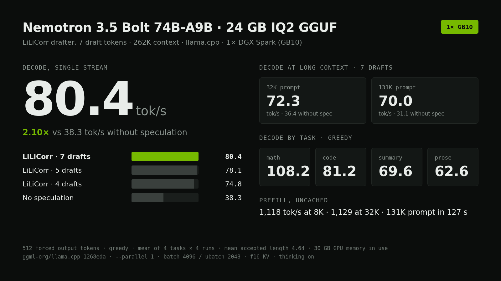

# Nemotron 3.5 Bolt on one DGX Spark

## Run it

```bash
git clone https://github.com/sxuff/nemotron-3.5-bolt-gb10 && cd nemotron-3.5-bolt-gb10 && ./run.sh
```

Expected: **80.4 tok/s** greedy decode, single stream, 512 forced tokens (mean of code/prose/math/summary) — receipt: [`results.json`](results.json)

The fastest single-GB10 recipe we measured for NVIDIA Nemotron 3.5 Bolt 74B-A9B 24GB (2-bit IQ2 GGUF): llama.cpp, the LiLiCorr drafter with 7 draft tokens, 262K context.



## Result

| Config | Decode, greedy | Decode, sampled | Mean accepted length | Prefill 2K | Prefill 8K | Prefill 32K |
|---|---:|---:|---:|---:|---:|---:|
| **LiLiCorr, 7 drafts (this recipe)** | **80.4** | **74.1** | 4.64 | 1,001 | 1,118 | 1,129 |
| LiLiCorr, 6 drafts | 80.6 | 73.8 | 4.46 | 987 | 1,113 | 1,126 |
| LiLiCorr, 5 drafts | 78.1 | 72.0 | 4.14 | 994 | 1,116 | 1,127 |
| LiLiCorr, 4 drafts | 74.8 | 67.0 | 3.77 | 1,007 | 1,122 | 1,130 |
| No speculation | 38.3 | 38.3 | | 1,159 | 1,277 | 1,276 |

All values tok/s, single stream, 262K context, thinking on. Decode is the mean of 4 tasks. The 7- and 6-draft rows are pooled over 4 runs each; the others are one run.

Decode by task, 7 drafts, greedy: math 108.2, code 81.2, summary 69.6, prose 62.6 tok/s.

**Long context.** Speculation holds up as the prompt grows:

| Prompt | 7 drafts | No speculation | Speedup |
|---:|---:|---:|---:|
| 32K | 72.3 | 36.4 | 1.99× |
| 131K | 70.0 | 31.1 | 2.25× |

A 131K-token prompt takes 127 s to first token (1,033 tok/s) with the drafter loaded, 114 s (1,149 tok/s) without it.

**Memory.** About 30 GB of GPU memory with the full 262K context, vision projector and drafter loaded. About 80 GB of the GB10's 128 GB stays free.

## Run it

Requirements: one GB10 (128 GB unified memory), CUDA 13, and a llama.cpp build that includes Nemotron 3.5 Bolt (`cd0a5b6`) and LiLiCorr (`843e7dc`) support. We used `1268eda`.

```bash
git clone https://github.com/ggml-org/llama.cpp ~/src/llama.cpp
cd ~/src/llama.cpp && git checkout 1268edac579110aeb1407f7928f53193ed4e28d4
cmake -B build -DGGML_CUDA=ON -DGGML_NATIVE=ON -DCMAKE_CUDA_ARCHITECTURES=121a-real \
  -DCMAKE_BUILD_TYPE=Release -DLLAMA_BUILD_UI=OFF
cmake --build build -j --target llama-server

hf download nvidia/NVIDIA-Nemotron-3.5-Bolt-74B-A9B-24GB-GGUF \
  NVIDIA-Nemotron-3.5-Bolt-74B-A9B-24GB.gguf mmproj-NVIDIA-Nemotron-3.5-Bolt-74B-A9B-24GB.gguf \
  --revision 188282901e3b6f8169aff9de69022a78350259b0 \
  --local-dir ~/models/NVIDIA-Nemotron-3.5-Bolt-74B-A9B-24GB-GGUF
hf download nvidia/NVIDIA-Nemotron-3.5-Bolt-74B-A9B-24GB-LiLiCorr-GGUF \
  NVIDIA-Nemotron-3.5-Bolt-74B-A9B-24GB-LiLiCorr.gguf \
  --revision f640c389aa24ddbe13150ef8753495446a488858 \
  --local-dir ~/models/NVIDIA-Nemotron-3.5-Bolt-74B-A9B-24GB-LiLiCorr-GGUF

LLAMA=~/src/llama.cpp ./serve.sh
```

The server listens on `127.0.0.1:8090` and is ready about 8 seconds after launch with a warm page cache.

```bash
curl -s http://127.0.0.1:8090/v1/chat/completions -H 'Content-Type: application/json' -d '{
  "messages": [{"role": "user", "content": "Compute 17*23. Reply with only the integer."}],
  "max_tokens": 4096, "temperature": 0}'
```

Reasoning is on by default. Send `"chat_template_kwargs": {"enable_thinking": false}` to turn it off. Reasoning and answer share `max_tokens`.

## What we changed from NVIDIA's command

Nothing. `serve.sh` is NVIDIA's published 128 GB ("32GB recipe") command with a served-model alias and a bind address. Everything we tried on top of it was slower or within noise:

- **6 drafts instead of 7.** 80.6 vs 80.4 tok/s greedy over 4 runs each. That's a tie. 7 accepts more tokens per step (4.64 vs 4.46), and was faster at 131K context in a single run (70.0 vs 62.9 tok/s).
- **4 or 5 drafts.** 74.8 and 78.1 tok/s. Fewer drafts means fewer accepted tokens per step.
- **q8_0 KV cache.** 81.8 vs 80.5 tok/s with f16 at 6 drafts, inside run-to-run spread. Cache memory isn't the constraint on a 128 GB box, so it's left at f16.
- **Draft confidence cut-off** (`--spec-draft-p-min`). 0.2 changed nothing (80.8), 0.5 was slower (75.9).
- **Prefill batch geometry.** ubatch 1024 or 4096, batch 8192, and a smaller draft ubatch all landed within 1,060 to 1,150 tok/s at 32K. The 2048 ubatch default is kept.
- **cuBLAS instead of llama.cpp's quantized matmul kernels** (`GGML_CUDA_FORCE_CUBLAS`). Prefill fell from 1,334 to 824 tok/s at 8K (`llama-bench`, no drafter).

## Limits

- **Prefill is the slow part.** Around 1,100 tok/s, against about 2,400 for the larger Nemotron 3.5 Super NVFP4 on vLLM on the same box. An Nsight Systems profile of a 4K prefill (`llama-bench`, ubatch 2048) shows 33% of GPU time in the IQ2_XXS quantized matmul kernel and another 8% in the NVFP4 one (NVFP4 holds the Mamba layers, per the model card). Batch-size tuning does not move it. It needs faster kernels.
- **The drafter costs about 12% prefill** (1,129 vs 1,276 tok/s at 32K), because the drafter has to process the prompt too. For short-answer, long-prompt workloads, running without it is reasonable.
- **Outputs are not bit-identical to no-speculation runs.** Greedy text with and without the drafter diverges within the first few hundred characters, and draft depths 4 to 7 also differ slightly from each other. Both arms complete coherently, but this is not a lossless-decoding claim.
- **One stream.** `--parallel 1`, as in NVIDIA's recipe. Multi-user throughput was not tested.

## Functional checks on the recipe server

- `17*23` → `391`, `finish_reason=stop`, with and without thinking.
- Image: a generated PNG of the number 472 was read back as `472`. The model card's own benchmark chart (3,323 prompt tokens) was read correctly: "Nemotron 3.5 Bolt 74B-A9B-24GB with a score of 86.4" for GPQA Diamond.
- Tool calling: the model card's `get_inventory` example returned `get_inventory({"product":"keyboard"})` with `finish_reason=tool_calls`.

These are smoke tests. No accuracy benchmark was run.

## Method

- Decode: 512 forced output tokens (`ignore_eos`), one request at a time, 4 tasks (code, prose, math, long-document summary), greedy plus one sampled pass at T=1.0, top_p=0.95. Decode tok/s is llama-server's own `timings.predicted_per_second`. A client-side measurement from the SSE stream agrees within 0.01 tok/s.
- Prefill: uncached prompts (a unique nonce at the start, `cache_prompt=false`), `max_tokens=1`. Prefill tok/s is `timings.prompt_per_second`.
- Accepted length per verification step = output tokens / (output tokens − accepted draft tokens), from the server's per-request draft counters.
- Every server passed the `17*23` exact-answer smoke before measurement.
- The prompt corpus is the `src/*.cpp` and `docs/**/*.md` files of a llama.cpp checkout (`b9222`). Set `CORPUS_DIR` to use your own.

`results.json` has every row. `bench/bench.py` reproduces the measurements against a running server, `bench/analyze.py` summarizes them, and `bench/smoke.py` runs the functional checks.

## Pinned versions

- Model: `nvidia/NVIDIA-Nemotron-3.5-Bolt-74B-A9B-24GB-GGUF` @ `188282901e3b6f8169aff9de69022a78350259b0`
- Drafter: `nvidia/NVIDIA-Nemotron-3.5-Bolt-74B-A9B-24GB-LiLiCorr-GGUF` @ `f640c389aa24ddbe13150ef8753495446a488858`
- Runtime: `ggml-org/llama.cpp` @ `1268edac579110aeb1407f7928f53193ed4e28d4`, CUDA 13.0, driver 580.159.03
- SHA-256, verified against the pinned Hub revisions:
  - `NVIDIA-Nemotron-3.5-Bolt-74B-A9B-24GB.gguf`: `91d63363e782c8a3d5f4be42816eba8e0d42dd2530bd07a7d0d2dc440599af75`
  - `mmproj-NVIDIA-Nemotron-3.5-Bolt-74B-A9B-24GB.gguf`: `0ee891eadc7bf0cae6289b249c74eb1ef420534351f6ef8b64d49f0ca6a926b0`
  - `NVIDIA-Nemotron-3.5-Bolt-74B-A9B-24GB-LiLiCorr.gguf`: `080e1ea41c9562a7804dbf30c6fbd4d17e216c6b8ff666f88e6edb1816010194`

## Credits

Model, LiLiCorr drafter and serving command: NVIDIA. Runtime: llama.cpp.
Model license: [OpenMDW-1.1](https://openmdw.ai/license/1-1/).
